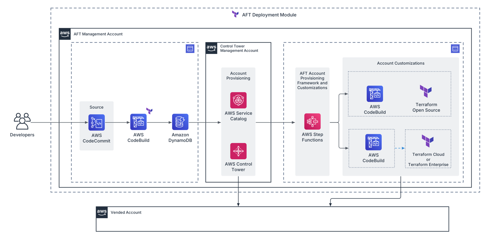
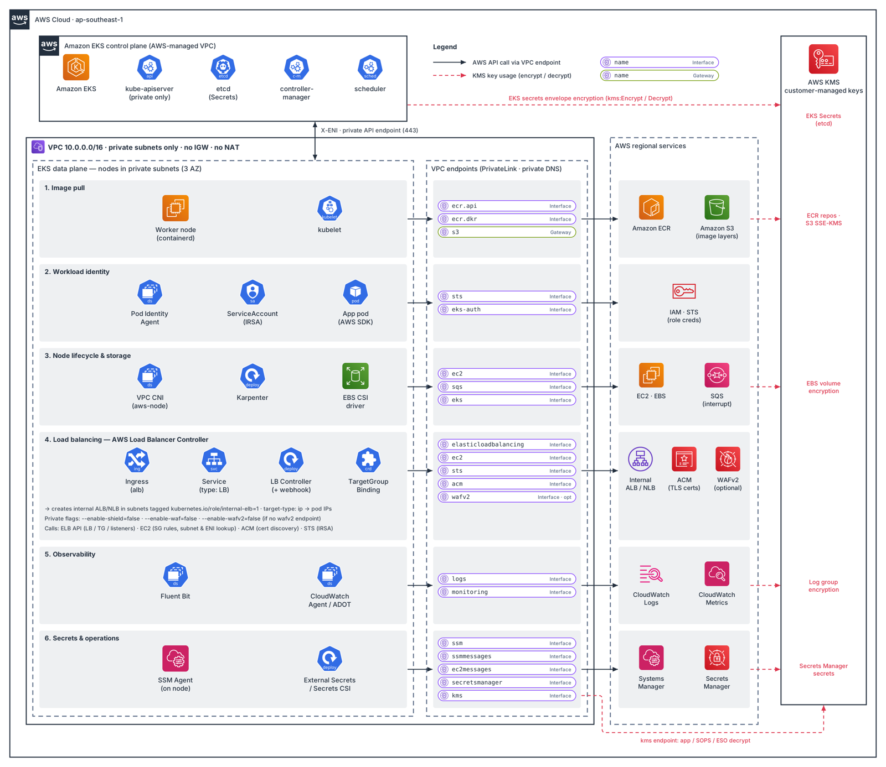
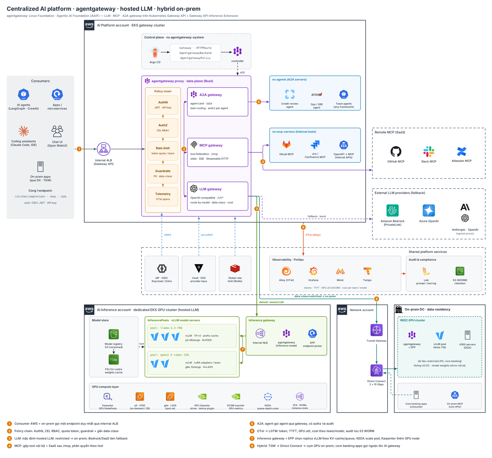
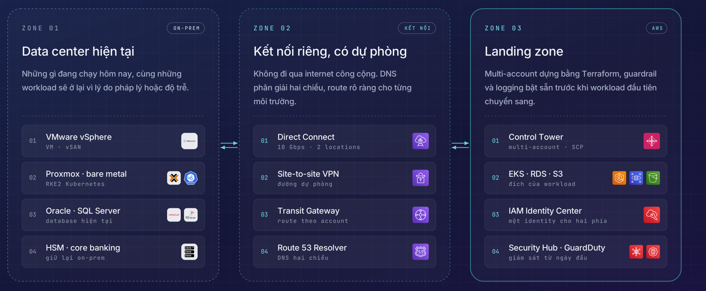

# vanlongme/skills

Plugin marketplace of reusable agent skills. Works with Claude Code (plugin marketplace) and with the
cross-agent [`skills`](https://skills.sh) CLI (Codex, Cursor, Gemini CLI, Copilot, OpenCode, …).

| Plugin | Skill | What it does |
|---|---|---|
| `arch-diagram` | [`arch-diagram`](plugins/arch-diagram/skills/arch-diagram/SKILL.md) | Lucidchart/AWS-style architecture diagrams (accounts, VPC tiers, K8s namespaces, official logos, edge-attached arrows) rendered to SVG + PNG from a short Python script |

## Install

**Claude Code**

```bash
/plugin install arch-diagram --marketplace vanlongme/skills
```

or in two steps:

```bash
/plugin marketplace add vanlongme/skills
/plugin install arch-diagram@vanlongme
```

The skill is invoked as `/arch-diagram:arch-diagram` (or picked up automatically when you ask for a diagram).
Update later with `/plugin marketplace update vanlongme`.

**Other agents** (Codex, Cursor, Gemini CLI, Copilot, OpenCode, …)

```bash
npx skills add vanlongme/skills               # pick agents interactively
npx skills add vanlongme/skills -a codex -g   # e.g. global install for Codex
```

**claude.ai**: zip `plugins/arch-diagram/skills/arch-diagram` and upload it as a custom skill.

> Private repo: the machine needs git access to `github.com/vanlongme/skills` (SSH key or `gh auth login`).

## First run (arch-diagram)

```bash
bash <skill-dir>/scripts/setup.sh   # pip deps + 24 brand logos + JetBrains Mono (Vietnamese mono text)
```

## Layout

```
.claude-plugin/marketplace.json            # marketplace catalog
plugins/<plugin>/.claude-plugin/plugin.json
plugins/<plugin>/skills/<skill>/SKILL.md   # + scripts/, examples/, assets/
```

Add a plugin: create `plugins/<name>/` with the same structure, append an entry to `marketplace.json`, bump
`version` in its `plugin.json`, then run `claude plugin validate .`.

## arch-diagram previews

| | |
|---|---|
|  |  |
|  |  |
|  |  |

Brand logos are trademarks of their owners; `fetch_logos.py` downloads them from public sources at setup
time instead of storing them in this repo.
