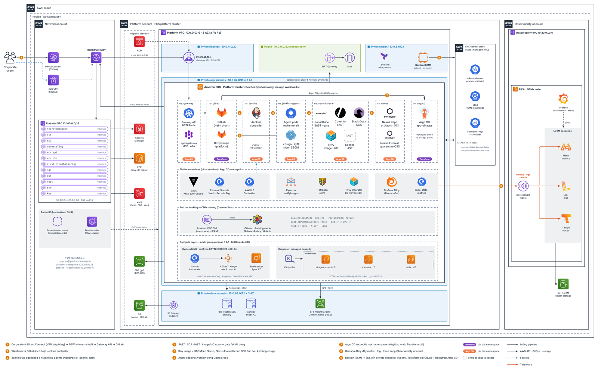
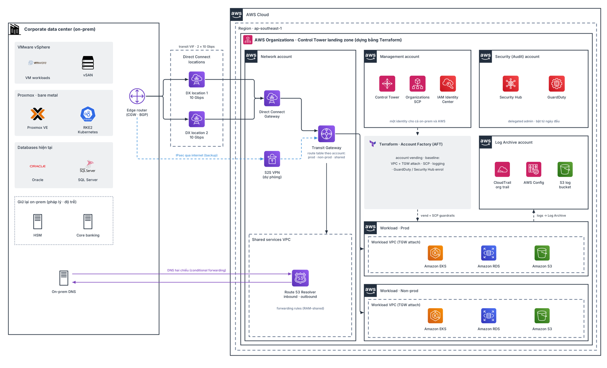

# skills

Reusable skills for Claude (claude.ai / Claude Code).

| Skill | What it does |
|---|---|
| [`arch-diagram`](arch-diagram/SKILL.md) | Lucidchart/AWS-style architecture diagrams (accounts, VPC tiers, K8s namespaces, official logos, edge-attached arrows) rendered to SVG + PNG from a short Python script |

## Use

**Claude Code**: copy (or symlink) a skill folder into `~/.claude/skills/`:

```bash
git clone git@github.com:vanlongme/skills.git
ln -s "$PWD/skills/arch-diagram" ~/.claude/skills/arch-diagram
bash skills/arch-diagram/scripts/setup.sh      # deps + logos + fonts
```

**claude.ai**: zip the `arch-diagram` folder and upload it as a custom skill.

## arch-diagram previews

| | |
|---|---|
|  |  |
|  |  |
|  |  |

Brand logos are trademarks of their owners; `fetch_logos.py` downloads them from public sources at setup
time instead of storing them in this repo.
